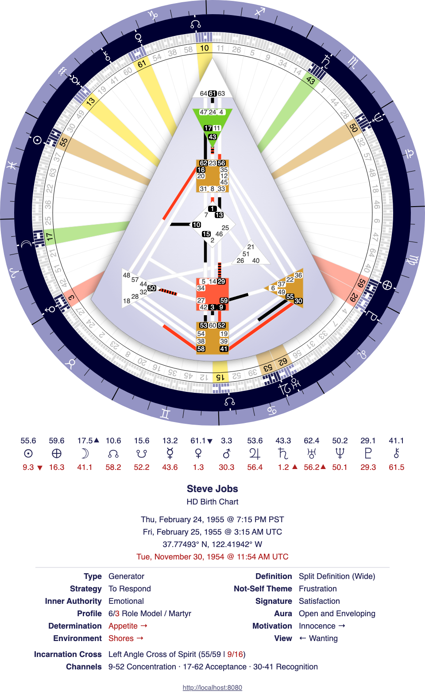
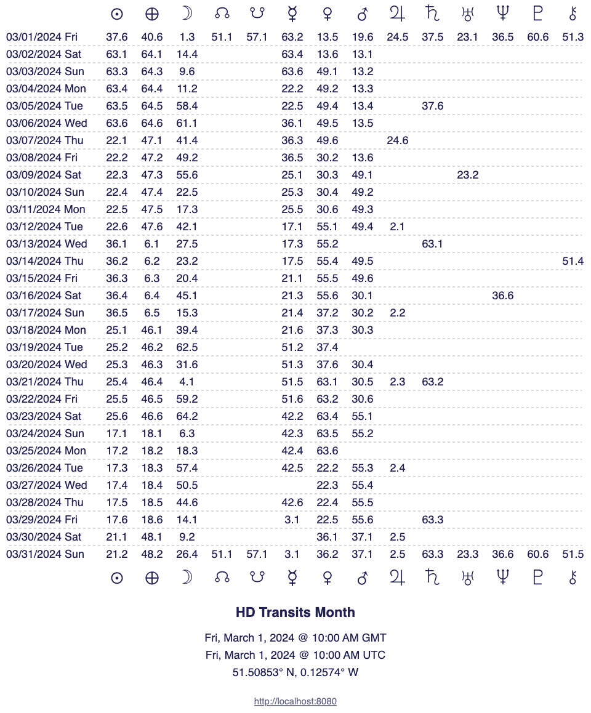

# Gates of Humanity

A web application that draws Human Design charts and transits, written in Java
with the [RIFE2](https://rife2.com) web framework and built with
[bld](https://rife2.com/bld). It's made by Geert Bevin at
[Uwyn](https://uwyn.com), and it runs at [hd.uwyn.com](https://hd.uwyn.com).

It draws five kinds of charts and two tables:

* a birth chart with its Type, Strategy, Authority, Profile, Definition,
  Incarnation Cross, channels and Variables,
* the transits of any moment, on their own or on top of a birth chart,
* a connection chart of two people, on its own or with the transits,
* the gate and line changes of every planet over a month or a day.

Below every chart, an Explore panel introduces each part of it, and tapping a
part of the chart opens its description. For a birth chart it also shows how
much earlier or later the birth could have been with each part staying the
same. The same descriptions are on the Learn pages. On a phone the wheel takes
the full width, and what the drawing lists below it is shown as text instead.
The button in the corner of a chart shows it full screen, where it's made
larger and moved around with the fingers, the mouse or the keys to read its
details, and where a tap on a part describes it as on the page. The two tables are HTML, and scroll sideways on a phone with their
dates staying in sight. A chart can be saved as a PNG image or an SVG drawing,
or printed, and a share link rebuilds the charts of a page from what follows
its `#`, which browsers never send to the server.

Everything is calculated in pure Java. There is no database and no native
library, and the application runs as a single jar, as a war or as a native
executable.

 

## Running

You need Java 25 or later.

```console
./bld compile run
```

bld downloads the dependencies the first time. Then open http://localhost:8080.
To build a standalone jar instead:

```console
./bld uberjar
java -jar build/dist/gatesofhumanity-2.0.0-uber.jar
```

Behind a reverse proxy, the site needs to know its public root URL, for
instance `https://charts.example.com`. Set it as `hdapp.proxyRootUrl`, which
can be an init parameter of the RIFE2 filter or of the servlet context in a
war's `web.xml`, or a Java system property, or set the `HDAPP_PROXY_ROOT_URL`
environment variable. Without it, the site runs in development mode and
disables caching. The port of the embedded server is set the same way, as
`gatesofhumanity.port` or `GATES_PORT`.

A few names start with `hdapp`, the name the project began under: the proxy root
URL, which servers that run the site set, what the pages store in a browser or
an app, the address `hdapp://app` that an app has its pages at, which is where
they store it, and the format `hdapp-charts` of a file of exported people. Under
another name the people that someone saved would be gone, and the files they
exported refused.

The pages say that the saved people stay in "this browser". An app that shows
the pages itself sets `gatesofhumanity.keptIn` to what they should say instead, "this
app" for instance, `gatesofhumanity.shareRootUrl` to the address of the site on the
web, which the links of the share button then start with and the drawings
then show.
The pages know which app they're in, as `gatesofhumanity.app`: "ios", "mac", "vision"
or "android", which the site has from RIFE2 there. RIFE2's own script, which
the head of a page includes in an app, marks the `html` of the page with the
classes `in-app` and `on-` with that name, which `main.css` has rules for, and
gives the page what a web view doesn't do by itself: printing, and on Android
sharing, saving a file and what a page posts. What these pages ask of their
app beyond that is in `js/app.js`. They tell the app who was saved, when a
page loads and each time that changes: each name with the moment of the birth
in UTC, in the order of the names with the one whose chart is shown first,
which is what a widget of the app needs. They tell it with
`rife2NativeApp.tell` of RIFE2's script, as `people`, and only what an app says
that it hears. So an app adds no script to a page.
An app can also keep the saved people somewhere else, for the other devices of
whoever uses it, as the apps of Apple do in iCloud. The pages work out who goes
where, in `appSynced` of `js/app.js`: the app only keeps and removes who they
say, which it hears as `elsewhere`, and tells them who's there and how that
changed by calling `appElsewhere`. Who both sides had when they were last
the same stays with what the pages keep, as `hdapp-same`.
On a wide screen the pages are a column of 900 pixels, which such an app
changes with `gatesofhumanity.columnWidth`: "none" for pages as wide as the screen.
The About page credits what the charts are made with, as [NOTICE.txt](NOTICE.txt)
does, and adds the sentences of `gatesofhumanity.credit` and `gatesofhumanity.widgetsCredit` to
it, for what such an app has inside it that the site alone doesn't. Below the credits it says which version
the app is, when `gatesofhumanity.version` is set, with the build number of `gatesofhumanity.build`.
The pages of the charts welcome a first visit once, with the name of the site
and what it's for, and remember that they did as `hdapp-welcomed` in the
storage of the browser. They welcome the first start of an app the same way,
where the welcome says "Tap" or, on a Mac, "Click" for how a part of a chart is
chosen, as `gatesofhumanity.tap`. The foot of every page has a link that shows the
welcome again: a page of a chart shows its own, and from any other page the
link leads to the Birth Chart, which shows it for the `#welcome` of its address.
Gates of Humanity is such an app, with the site compiled to native code inside
it and no server, for iPhone and iPad, see [ios/README.md](ios/README.md), a
Mac, see [mac/README.md](mac/README.md), Apple Vision Pro, see
[vision/README.md](vision/README.md), and Android, see
[android/README.md](android/README.md).

## A tour of the source

If you're here for RIFE2 and bld, these are the places to look:

* `src/main/java/gatesofhumanity/AppSite.java` declares every route as a field, with the
  path of a URL mapped to parameters, lambda routes for `robots.txt` and the
  sitemap, a fallback route for the addresses without a page, and the settings
  of the engine.
* `src/main/java/gatesofhumanity/elements` holds the elements, with `@Parameter`, `@Cookie`
  and `@ActiveSite` fields and URLs built from the routes with `urlFor`.
* `src/main/resources/templates` holds HTML, SVG, XML and text templates.
  `wheel.svg` is the whole chart, drawn by the template engine from blocks and
  values, without an image library. `wheel_summary.html` has the values and
  blocks of what the chart says below its wheel under the same names, so that
  the same code fills both and the text that phones show can't differ from
  the drawing. `range_table.html` is the table of a month or a day, which the
  page shows where a chart has its drawing.
* `AppSiteDeployed.java` and `src/main/webapp/WEB-INF/web.xml` run the same
  site from an uber jar, as a war or as a native executable, with a page of
  its own for errors.
* `AppSiteEmbedded.java` is the site inside an app, with what the widgets of
  the app show as routes of their own, see `ios/README.md`, and a chart as
  shapes for the room around the app for visionOS, see `vision/README.md`.
  `AppSiteProvider.java` hands it to RIFE2's `rife.nativeapp`, which runs a site
  inside an app, with what the pages say there, and `AppWalk.java` goes through
  its pages before a native library is built.
* `/embed/transits/small` and `/embed/transits/medium` are the transits of
  this moment as an SVG image for a page elsewhere, the drawings of those
  widgets, which `TransitsEmbed` answers. The About page shows both with what
  to copy into a page, where the pages are on the web and not in the app.
* `src/bld/java/gatesofhumanity/AppBuild.java` is the whole build, with the dependencies
  of each scope, the precompiled templates, and its own commands for the data
  generators and the native image. It extends `NativeAppProject` of RIFE2's bld
  extension for native apps, whose `app-library` builds the site as a native
  library for each kind of app, into `native`.
* `src/test/java/gatesofhumanity/AppTest.java` tests the site through RIFE2's
  `MockConversation`, without starting a server, and `src/test/java/gatesofhumanity/js` runs
  the browser scripts in GraalJS.

## Deploying as a war

```console
./bld war
```

This builds `build/dist/gatesofhumanity-2.0.0.war`, which runs in a Jakarta Servlet 6
container such as Jetty 12 with its `ee10` environment. Its `web.xml` runs the
site without development error pages. Copy it into Jetty's `webapps` as
`gatesofhumanity.war` and set the proxy root URL as an init parameter, for instance in a
context file next to it:

```xml
<?xml version="1.0" encoding="UTF-8"?>
<!DOCTYPE Configure PUBLIC "-//Jetty//Configure//EN" "https://jetty.org/configure_10_0.dtd">
<Configure class="org.eclipse.jetty.ee10.webapp.WebAppContext">
  <Set name="contextPath">/</Set>
  <Set name="war"><Property name="jetty.webapps"/>/gatesofhumanity.war</Set>
  <Call name="setInitParameter">
    <Arg>hdapp.proxyRootUrl</Arg>
    <Arg>https://charts.example.com</Arg>
  </Call>
</Configure>
```

When the image links on a chart point to the public URL and the Learn pages no
longer carry no-cache headers, the setting has been applied. The chart pages
always carry them, since they start at the current time.

## Native executable

With a GraalVM JDK 25 or later, the application can be built as a native
executable that starts its server in milliseconds:

```console
./bld native
GATES_PORT=8080 build/dist/gatesofhumanity
```

`./bld native-check` starts the executable and checks that every route answers
as expected. The native image configuration in
`src/main/resources/META-INF/native-image/gatesofhumanity` is recorded by
`./bld native-config`, which runs the application under the GraalVM tracing
agent and visits every route listed in `src/bld/java/gatesofhumanity/NativeImage.java`.
Run it again, after adding a visit, whenever a route, template or resource is
added. The static files are included through
`META-INF/native-image/gatesofhumanity-webapp`, since the agent can't see them.

## Tests

```console
./bld compile test
```

The suite compares the calculated positions, design moments and activations
against 2000 reference charts computed with the Swiss Ephemeris, and checks the
gate and line boundaries against The Complete Rave I'Ching. It runs in a few
seconds. The browser scripts are tested too, in GraalJS, a JavaScript engine
for the JVM that bld downloads with the other test dependencies.

## Tools

The scripts in `Tools` need Node 22 or later, Python 3, Perl and Chrome, and
the ones that read a PDF need `pdftotext`.

To check that a test can fail, `Tools/mutation-check.sh` applies a Perl
substitution to a source file, runs the given test classes (or all of them)
against a clean build, lists the tests that caught it and restores the file,
also when interrupted:

```console
Tools/mutation-check.sh src/main/java/gatesofhumanity/models/Variables.java 's/tone <= 3/tone < 3/' gatesofhumanity.models.VariablesTest
```

It exits with 0 when a test caught the mutation, 1 when it survived and 2 when
the mutation didn't apply or compile.

To check a page in a real browser, `Tools/browser` drives a headless Chrome
from Node over the DevTools protocol, against a server started with
`./bld compile run`. `lib.mjs` opens pages in fresh browser contexts with real
clicks and keys, logs the console and failed requests, and saves screenshots
in `build/browser`. Its pages are past the welcome of a first visit, unless
`newPage` is given `welcome: true`. `shot.mjs` screenshots a page at desktop
and phone width, `check-entry.mjs` checks that the rows with the dates and
the cities have the same sizes on every chart page, at twelve widths from a
small phone to a wide screen, and `check-install.mjs` checks that Chrome can
install the site from `site.webmanifest` and that the site in a window of its
own scrolls inside it and leaves the welcome out:

```console
Tools/browser/chrome.sh start
node Tools/browser/shot.mjs /wheel/birth birth
node Tools/browser/check-entry.mjs
node Tools/browser/check-install.mjs
Tools/browser/chrome.sh stop
```

`chrome.sh` looks for Chrome where macOS has it, set `CHROME` to another
Chrome or Chromium binary elsewhere.

`Tools/compare` compares the site's charts with other open source calculators,
run locally and never part of the build: [pyhd](https://github.com/ppo/pyhd)
(Swiss Ephemeris) and [natalengine](https://github.com/Unforced-Dev/natalengine)
(astronomy-engine). `compare.py moments 10000` writes random moments from 1900
to 2100, `ExportCharts.java`, `pyhd_charts.py` and `natalengine.mjs` turn them
into charts, and `compare.py diff` compares every activation and everything
derived from them:

```console
java -cp "build/main:src/main/resources:lib/compile/*" Tools/compare/ExportCharts.java moments.txt > site.jsonl
```

## How the charts are calculated

* Positions are geocentric apparent ecliptic longitudes of date, the same as
  the defaults of the Swiss Ephemeris. The lunar node is the true (osculating)
  node.
* The Design is the moment the Sun was 88 degrees of longitude before its
  position at birth.
* Type, Authority, Profile, Definition and the angle of the Incarnation Cross
  follow The Definitive Book of Human Design. The tests check them against the
  book's sample charts, Jovian Archive's published charts of Steve Jobs and
  Stephen King, and the published charts of a dozen public figures.
* Earth is opposite the Sun and the South Node is opposite the North Node.
  Chiron is shown but doesn't activate gates.
* Gate 41 starts at 302 degrees (2 degrees Aquarius). Each gate covers 5.625
  degrees and each line 0.9375 degrees, including its start and excluding its
  end. Each line divides into six colors and each color into six tones, the
  same way.
* The Variables come from the color and tone of the Design Sun
  (Determination), the Design Nodes (Environment), the Personality Sun
  (Motivation) and the Personality Nodes (Perspective, also called View).
  Tones 1 to 3 face left, 4 to 6 right. A tone is 93.75 arcseconds of
  longitude, about 38 minutes of the Sun's motion, so they need a birth time
  accurate to a few minutes.
* A line is fixed in exaltation or detriment by its planet anywhere in the same
  gate or in the harmonic gate at the other end of a channel, from the
  Personality as well as the Design. In a birth transit chart the transits
  fix lines of the birth chart, and in a connection chart each person fixes
  lines of the other, temporarily. A line that only another chart fixes is
  drawn with an outlined triangle, its own fixings with a filled one. These follow
  [Line Fixing in Human Design](https://jovianarchive.com/blogs/chart-interpretations-components/line-fixing-in-human-design-exaltation-detriment-and-juxtaposition),
  whose examples are among the tests.

The ephemeris covers 1800-01-03 to 2199-12-17, so birth charts can be made from
1800-04-08. The tests require the positions to agree with the Swiss Ephemeris
within 6 arcseconds for every body up to 2025, and the design moments within 3
seconds. Most bodies agree within 2 arcseconds, Chiron within 5. Further in the
future, the two predict the rotation of the Earth differently, which moves the
Moon by up to a minute of arc by 2200. A line is 3375 arcseconds wide.

## Data

The data the application needs is in `src/main/resources` and is only
regenerated when it has to change. Downloads are cached in `.cache`.

* `ephemeris/*.bin` are Chebyshev series fitted to the
  [JPL Horizons](https://ssd.jpl.nasa.gov/horizons/) ephemerides, regenerated
  with `./bld generate-ephemeris`. Name bodies to regenerate only those, for
  instance `./bld generate-ephemeris moon true_node`.
* `cities.tsv.gz` holds the cities of 5000 people or more from
  [GeoNames](https://www.geonames.org), with the other names of the cities of
  15,000 people or more, such as Cologne for Köln, regenerated with
  `./bld generate-cities`.
* `crosses.tsv` holds the names of the 192 Incarnation Crosses, extracted from
  the Global Incarnation Cross Index of The Definitive Book of Human Design with
  `Tools/generate-crosses.py`, which checks every cross against the geometry of
  the wheel.
* `channels.tsv` holds the names of the 36 channels from the same book,
  extracted with `Tools/generate-channels.py`.
* `gates.tsv` holds the names of the 64 gates and of their I Ching hexagrams
  from the same book, extracted with `Tools/generate-gates.py`.
* `src/test/resources/dignities.tsv` holds the planets that exalt each of the
  384 lines and the planet in detriment, extracted from The Complete Rave
  I'Ching with `Tools/generate-dignities.py`. The tests compare it with the
  dignities in the code, as they do the hexagrams with the rule that opposite
  gates on the wheel have complementary hexagrams.
* `images/og-image.png` in `src/main/webapp`, the link preview of every page,
  is rendered with headless Chrome by `Tools/generate-images.sh` from a server
  started with `./bld compile run`. After rendering a new link preview, raise
  the `v` parameter of its `og:image` in `templates/head.html`, since Facebook
  keeps the image of a URL it has seen. The icon of the site is the one of the
  app: `ios/icon.py` draws `images/favicon.svg`, `images/apple-touch-icon.png`
  and the emblem of the welcome, `images/emblem.svg`, along with it.
* `explore.tsv` holds the descriptions of the Explore panels and the Learn
  pages, written for this site. The tests check that every part of a chart has
  one, and that every part that can be tapped opens one.
* `Tools/generate-oracle.py` regenerates the Swiss Ephemeris reference charts
  in `src/test/resources/oracle`. It needs a local Swiss Ephemeris build with
  `swetest`, which nothing else in the project depends on:
  `Tools/generate-oracle.py /path/to/swisseph > src/test/resources/oracle/swisseph.csv`

## Saved people

The saved people, with their birth date, time and place, and the last used
birth data stay in the browser's local storage. Anyone saved can be loaded
into any chart. People can be given a group, such as Family or Friends. The
Saved people window of a chart lists them under their group and can show one
group at a time. The People page of the menu lists them too, and is where
someone is added with their birth date, time and city, renamed, put in another
group or deleted, and opened in a chart. The page is filled in by the browser,
the server has nobody to list.

To draw a chart, the browser sends its date, place and name to the server, and
the application uses them for that answer without keeping them. The server
only remembers the id of the location charts are seen from, in a cookie, to
start pages at the local time there.

Until a city is chosen, a page starts at the most populated city of the time
zone that the browser is set to, New York for America/New_York, and at London
when the zone has no city. The browser asks the server for that city by the
name of the zone and keeps the answer. The time there is the visitor's own,
the city often isn't, and it's never remembered as one that they chose.

Browsers can clear what a site stores. Safari does after 7 days of browsing
without a visit, unless the site was added to the home screen. Export on the
People page keeps a copy as a file, which is the only sure backup, and Import
brings it back or onto another browser.

## License

Gates of Humanity is licensed under the Apache License, Version 2.0, the same as RIFE2.
See [LICENSE.txt](LICENSE.txt), and [NOTICE.txt](NOTICE.txt) for the data and
libraries it includes, among which the GeoNames city data under CC BY 4.0.
